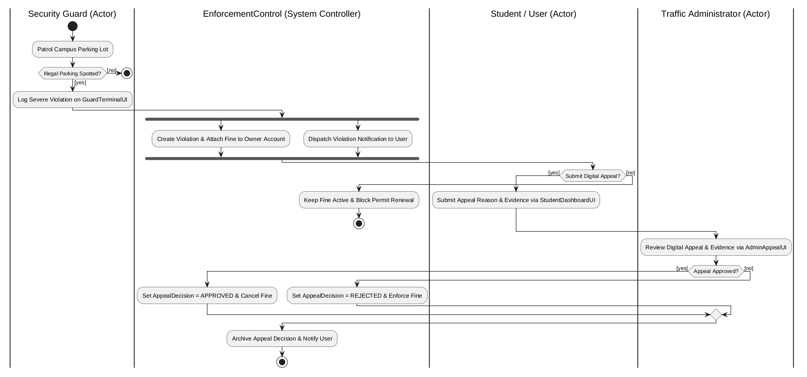
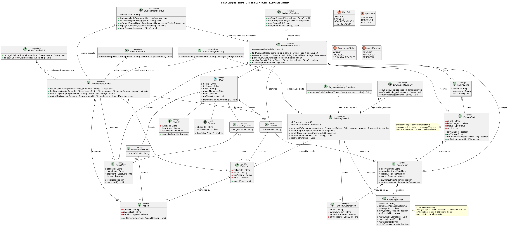
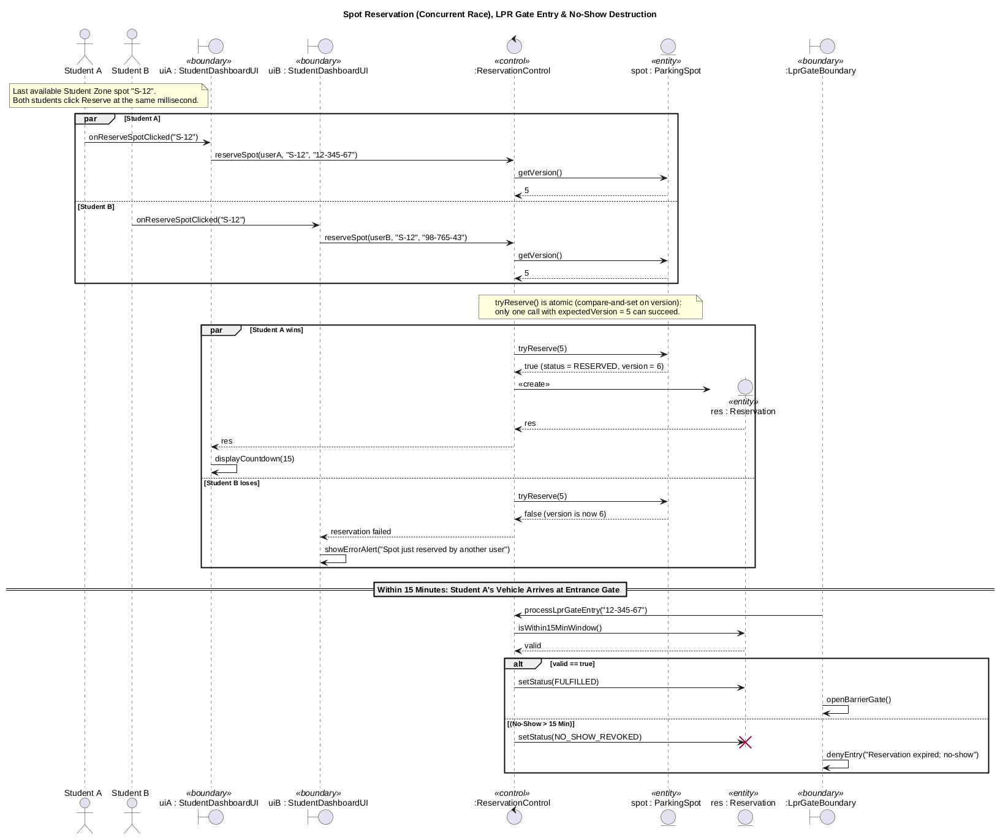
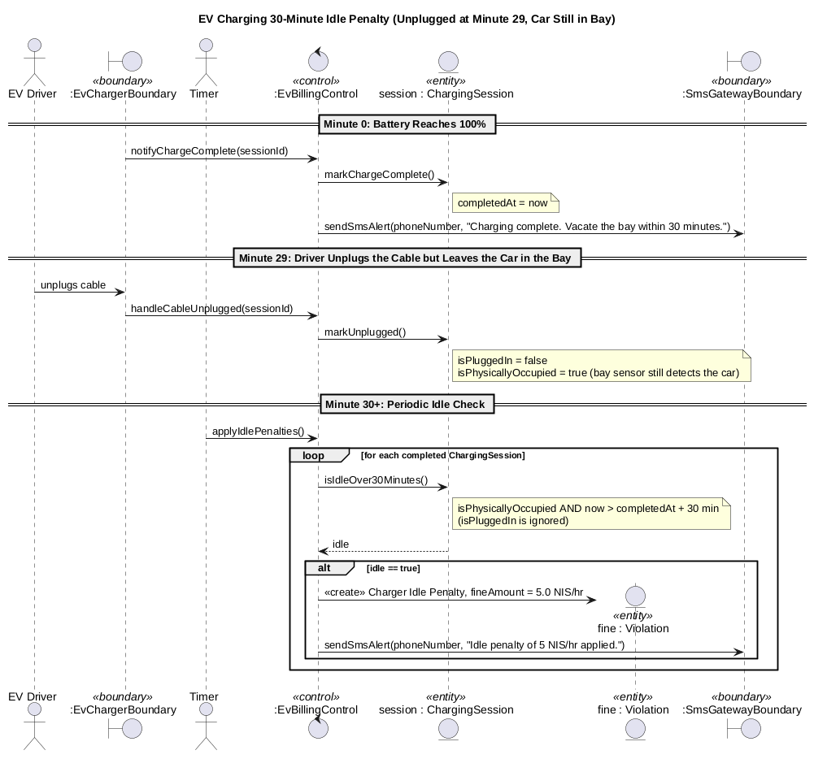

---

## 1. Team Members

| Name | 
|---|
| Dmitry Chybisov|
| Tomer Pine |

**GitHub repository:** https://github.com/TomerPine/Ex4_SmartParking_Design

---

## 2. UML Diagrams

The PlantUML sources are in [`diagrams/`](diagrams/). Each PNG below is rendered from the `.puml` file with the same name.

### 2.1 Activity Diagram — Violation Logging and Digital Appeal

### 2.2 ECB Class Diagram

### 2.3 ECB Sequence Diagram — Concurrent Spot Reservation, LPR Gate Entry, and No-Show

### 2.4 ECB Sequence Diagram — EV Charger Idle Penalty

---

## 3. ECB Component Responsibility Table

Boundary classes talk only to control classes. Control classes coordinate the use cases and are the only classes that read or change entities.

### 3.1 Boundary Classes

| Component | Connected to | Responsibility |
|---|---|---|
| `StudentDashboardUI` | `ReservationControl`, `EnforcementControl` | Lets Students and Faculty search for available spots in their allowed zones, reserve a spot, see the 15-minute countdown, see error alerts, and submit digital appeals. |
| `GuardTerminalUI` | `EnforcementControl` | The Security Guard's mobile terminal for logging severe violations and issuing guest QR passes. |
| `AdminAppealUI` | `EnforcementControl` | Lets the Traffic Administrator approve or reject digital appeals. |
| `LprGateBoundary` | `ReservationControl` | Connects to the external LPR cameras. Reports scanned plates and guest QR codes, then opens the barrier or denies entry. |
| `PaymentGatewayBoundary` | `EvBillingControl` | Connects to the external payment gateway to authorize the credit card before EV charging. |
| `SmsGatewayBoundary` | `EvBillingControl`, `EnforcementControl` | Connects to the external SMS gateway for charge-complete alerts, idle-penalty alerts, and violation notices. |
| `EvChargerBoundary` | `EvBillingControl` | Connects to the EV charger and bay sensor. Reports charge completion, cable unplugging, and the bay being vacated. *(Added by the team; the system story does not name this class.)* |

### 3.2 Control Classes

| Component | Entities managed | Responsibility |
|---|---|---|
| `ReservationControl` | `User`, `Vehicle`, `ParkingZone`, `ParkingSpot`, `Reservation`, `GuestPass` | Filters spots by role (Students see only the Student Zone; Faculty see all zones). Creates 15-minute reservations using the atomic `tryReserve(expectedVersion)` check. Handles LPR gate entry for permit holders and guest QR passes. Revokes no-show reservations and increments `noShowWarnings`. |
| `EvBillingControl` | `PaymentAuthorization`, `ChargingSession`, `Violation` | Authorizes EV payment before charging. Records charge completion and sends the SMS alert. Tracks cable and bay state. Creates the 5 NIS/hour Charger Idle Penalty when the car is still in the bay 30 minutes after charging completes. |
| `EnforcementControl` | `Vehicle`, `GuestPass`, `Violation`, `Appeal` | Issues guest passes. Logs severe violations, attaches the fine to the owner's account (blocking permit renewal), and sends the violation notice at the same time. Accepts digital appeals and applies the administrator's decision. |

### 3.3 Entity Classes

| Component | Responsibility |
|---|---|
| `User` (abstract) | Common user data, role, and the `noShowWarnings` counter. |
| `Student`, `Faculty` | Registered drivers who can hold an active parking permit. |
| `SecurityGuard` | Logs violations and issues guest passes. |
| `TrafficAdministrator` | Reviews digital appeals. |
| `Vehicle` | A license plate owned by a user. Links reservations and violations to their owner. |
| `GuestPass` | A temporary single-use QR token for a guest vehicle. |
| `ParkingZone` | A group of spots (for example, the Student Zone). Aggregates `ParkingSpot`. |
| `ParkingSpot` | A standard or EV spot with a `status` and a `version` counter for safe concurrent reservation. |
| `Reservation` | A 15-minute hold on a spot. Owns its `PaymentAuthorization` and `ChargingSession` (composition). |
| `PaymentAuthorization` | The credit card authorization required before EV charging. |
| `ChargingSession` | Tracks `completedAt`, `isPluggedIn`, and `isPhysicallyOccupied` separately, so idle time is measured by bay occupancy rather than cable state. |
| `Violation` | A severe violation or an idle penalty, with its fine amount and payment status. Owns an optional `Appeal`. |
| `Appeal` | A digital appeal with its reason and a `PENDING` / `APPROVED` / `REJECTED` decision. |

---

## 4. AI Critique Prompt and Applied Improvements

### 4.1 Verbatim Prompt

> @SYSTEM_STORY.md @diagrams/class_diagram_ecb.puml @diagrams/sequence_reservation_ecb.puml audit UML diagrams against two edge cases in Section 3 of System Story, like:
> 1. Two students simultaneously click Reserve on the last available spot in Student Zone at the exact same millisecond.
> 2. An EV driver unplugs the charging cable at minute 29 without physically moving the car out of the EV bay.

### 4.2 Summary of the AI Critique

The AI confirmed that the class diagram had the required elements: `version` and `tryReserve(expectedVersion)` on `ParkingSpot`, and separate `isPluggedIn` and `isPhysicallyOccupied` attributes on `ChargingSession`. It found that neither sequence diagram actually showed its edge case happening.

**Edge case 1: simultaneous reservation**
1. The race was not shown. There was only one student lifeline.
2. The UI sent an `expectedVersion` that it never received; it was only given spot IDs.
3. The `alt` guards used values with no return messages.
4. No Student Zone check, and the example spot was an EV spot with no payment step.
5. A no-show did not free the spot or increment `noShowWarnings`, and revocation happened only at the gate instead of on a timer.

**Edge case 2: unplugged at minute 29, car still in the bay**
1. The unplug event was not shown, and the class diagram had no operations or boundary to record it.
2. `isIdleOver30Minutes()` did not say whether it checks the cable or the bay.
3. A new fine would be created on every scheduler run instead of accruing 5 NIS per hour.
4. The guard read `isPhysicallyOccupied` without a message to fetch it.
5. The fine was not attached to a vehicle, and the SMS phone number had no source.
6. The scheduler was not an ECB element.

### 4.3 Applied Improvements

| # | Improvement | Files changed |
|---|---|---|
| 1 | **The race is now shown.** Two students with separate dashboards both read version 5 inside a `par` block. A's `tryReserve(5)` succeeds and the version becomes 6. B's `tryReserve(5)` fails, no reservation is created for B, and B sees an error. A note states that `tryReserve` is an atomic compare-and-set. | `sequence_reservation_ecb.puml`, `class_diagram_ecb.puml` |
| 2 | **The minute-29 unplug is now shown.** The sequence runs in three steps: charging completes at minute 0, the driver unplugs at minute 29 (`isPluggedIn = false`, `isPhysicallyOccupied = true`), and the idle check after minute 30 creates the penalty. Supporting additions: the new `EvChargerBoundary`; `handleCableUnplugged()` and `handleBayVacated()` on `EvBillingControl`; and `markChargeComplete()`, `markUnplugged()`, and `markVacated()` on `ChargingSession`. | `sequence_idle_penalty_ecb.puml`, `class_diagram_ecb.puml` |
| 3 | **The idle rule is now defined.** A note on `ChargingSession` defines `isIdleOver30Minutes()` as `isPhysicallyOccupied AND now > completedAt + 30 min`, ignoring `isPluggedIn`. | `class_diagram_ecb.puml`, `sequence_idle_penalty_ecb.puml` |
| 4 | **The UI no longer needs the version.** `reserveSpot()` no longer takes `expectedVersion`; `ReservationControl` reads it with the new `ParkingSpot.getVersion()`. | `class_diagram_ecb.puml`, `sequence_reservation_ecb.puml` |
| 5 | **Guards now use returned values.** Return messages were added for `getVersion()`, `tryReserve()`, `isWithin15MinWindow()`, and `isIdleOver30Minutes()`. | both sequence diagrams |
| 6 | **The scheduler is now a `Timer` actor**, replacing the non-ECB `<<system>>` participant. | `sequence_idle_penalty_ecb.puml` |

### 4.4 Remaining Items

These critique points were not applied:

- The reservation flow does not check that a Student may reserve only in the Student Zone.
- A no-show does not set the spot back to `AVAILABLE` or call `incrementNoShowWarnings()`, and revocation is still triggered at the gate rather than by `revokeExpiredReservations()` on a timer.
- The idle check creates a new `Violation` on each run instead of accruing 5 NIS per hour on one fine.
- The idle-penalty `Violation` is not attached to a `Vehicle`, and the SMS phone number's source (ChargingSession → Reservation → Vehicle → User) is not shown.
